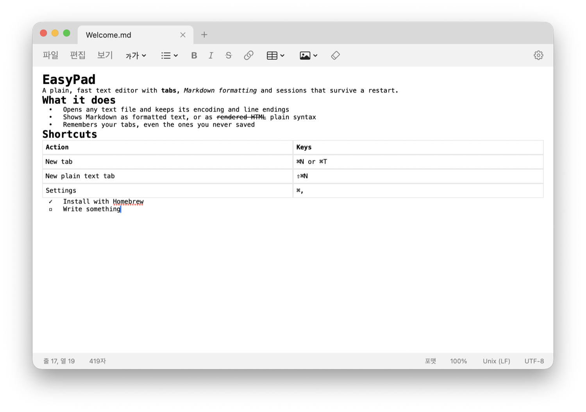

**Language:** English | [한국어](README.ko.md)

# EasyPad

> The Windows 11 Notepad, rebuilt as a native text editor for macOS.



```sh
brew install dmnkx/easypad/easypad
```

## What is EasyPad?

The Notepad that ships with Windows 11 is an editor with tabs, sessions that survive a restart, and light Markdown formatting. EasyPad is a native Swift and AppKit app that brings the same layout and the same features to macOS.

It is not a port of the original executable. The menus and interface text were read from an installed copy of Notepad, and the app was written from scratch to match them. EasyPad is not made or endorsed by Microsoft and has no connection to Microsoft.

This repository is both the source and a Homebrew tap (`dmnkx/easypad`). Installing downloads a build from GitHub Releases.

## Key Features

- **Tabs in the title bar** — each tab has a close button, and a tab with unsaved changes shows a dot (●).
- **Sessions** — quitting keeps your open tabs, unsaved text included, and brings them back on the next launch. It does not ask about saving.
- **Markdown formatting** — edit headings, bold, italic, strikethrough, links, bulleted, numbered and task lists, tables and images as formatted text. Switch to the plain syntax view at any time.
- **Encodings and line endings kept** — ANSI, UTF-8, UTF-8 with BOM and UTF-16 LE/BE, with CRLF, LF or CR, are detected on open and preserved on save.
- **The rest of Notepad** — find and replace, go to line, time/date, zoom, word wrap, status bar, printing with headers and footers, and `.LOG` files.
- **English and Korean** — follows the macOS language setting.
- **Universal** — runs on both Apple Silicon and Intel Macs.

## Requirements

- macOS 13 (Ventura) or later
- [Homebrew](https://brew.sh), when installing with Homebrew

## Install

### Homebrew (recommended)

```sh
brew install dmnkx/easypad/easypad
```

This installs `/Applications/EasyPad.app`. If you add the tap first, the short name is enough:

```sh
brew tap dmnkx/easypad
brew install easypad
```

### Direct download

1. Download `EasyPad.zip` from [Releases](https://github.com/dmnkx/homebrew-easypad/releases/latest) and unzip it.
2. Move `EasyPad.app` to the Applications folder.
3. EasyPad is not notarized by Apple, so macOS blocks a copy downloaded this way the first time you open it. Run this once in Terminal:

   ```sh
   xattr -dr com.apple.quarantine /Applications/EasyPad.app
   ```

   Or open the app once to see the warning, then click **Open Anyway** at the bottom of **System Settings > Privacy & Security**.

Installing with Homebrew takes care of this step for you.

## Usage

### Tabs and windows

| To do this | Use |
| --- | --- |
| New tab (Markdown) | `⌘N` or `⌘T`, or `+` on the tab strip |
| New plain text tab | `⇧⌘N` or `⇧⌘T` |
| New window | File > New window |
| Next / previous tab | `⌃Tab` / `⌃⇧Tab` |
| Close tab | `⌘W`, or the tab's `×` |
| Close window (every tab) | `⇧⌘W` |
| Close other tabs, close tabs to the right | Right-click a tab |

A new tab starts as a Markdown document. Open a plain text tab when you only want unformatted text.

### Files

| To do this | Use |
| --- | --- |
| Open | `⌘O` (any extension) |
| Save | `⌘S` |
| Save as | `⇧⌘S` (choose the file type and encoding) |
| Save all | `⌥⌘S` |
| Print | `⌘P` |
| Page setup | File > Page setup (header, footer, margins) |

Dropping a file on the EasyPad icon in the Dock opens it too.

### Markdown formatting

Apply formatting with the buttons on the menu row inside the window, or from the Format menu.

| Formatting | Shortcut | Markdown saved |
| --- | --- | --- |
| Six heading levels | Headings button on the menu row | `#` to `######` |
| Bold | `⌘B` | `**text**` |
| Italic | `⌘I` | `*text*` |
| Strikethrough | `⇧⌘X` | `~~text~~` |
| Link | `⌘K` | `[text](address)` |
| Lists | Lists button on the menu row | `-`, `1.`, `- [ ]` |
| Table | Table button on the menu row | `\| a \| b \|` |
| Image | Image button on the menu row | `` |
| Clear formatting | `⌘\` | |

- **Tables** are inserted by picking a size with the mouse on the grid under the Table button. The same menu adds and removes rows and columns.
- **Images**: when you save, an inserted image is copied into a `<document name>_Images` folder next to the document, and the document records the relative path. Move the document and that folder together and the images still show on another computer.
- **View > Markdown** switches between the formatted view and the syntax view.
- Saving a plain text file after formatting it asks whether to save it as a Markdown file.

### Editing and viewing

| To do this | Shortcut |
| --- | --- |
| Find | `⌘F` |
| Find next / previous | `F3` / `⇧F3` |
| Replace | `⌥⌘F` |
| Go to line | `⌘G` |
| Insert time/date | `F5` |
| Search the selection with Bing | `⌘E` |
| Zoom in / out / reset | `⌘=` / `⌘-` / `⌘0` |
| Word wrap | `⌥Z` |

If the first line of a file is `.LOG`, the current time and date are appended every time it is opened.

### Settings

Press `⌘,` or click the gear at the right of the menu row. Settings open as a tab.

- **Appearance** — app theme (use system setting, light, dark)
- **Text formatting** — font, word wrap, formatting on or off
- **Opening EasyPad** — open files in a new tab or a new window, continue the previous session on launch, recent files
- **Spelling** — spell check, autocorrect

## Update

```sh
brew upgrade easypad
```

## Uninstall

```sh
brew uninstall easypad
```

Add `--zap` to remove the settings and the kept session, unsaved text included:

```sh
brew uninstall --zap easypad
```

Remove the tap as well if you no longer need it:

```sh
brew untap dmnkx/easypad
```

If you installed without Homebrew, delete these yourself:

- `/Applications/EasyPad.app`
- `~/Library/Application Support/EasyPad` — the kept session
- `~/Library/Preferences/io.github.dmnkx.easypad.plist` — settings

## Known limitations

- EasyPad is not notarized by Apple. A copy obtained outside Homebrew needs the step above on first launch.
- Tabs cannot be dragged to reorder them or to tear them off into a window.
- Find and replace use the standard macOS find bar, which looks different from the original's find box.
- Images inserted by web address are not downloaded; a placeholder icon is shown.
- Block quotes, horizontal rules and code blocks are shown as written, not drawn as formatting.
- The original's Copilot features (Write, Rewrite, Summarise) are tied to a Microsoft account and service and are not included.

## Build from source

Requires the Xcode Command Line Tools (`xcode-select --install`).

```sh
git clone https://github.com/dmnkx/homebrew-easypad.git
cd homebrew-easypad
swift test                 # run the tests
sh scripts/bundle.sh       # builds build/EasyPad.app
```

Releases are cut with `sh scripts/release.sh <version>`, which bumps the version, runs the tests, builds, updates the cask and uploads to GitHub Releases.

The work log, design decisions and notes from analysing the original are in [PROCESS.md](PROCESS.md) (Korean).
